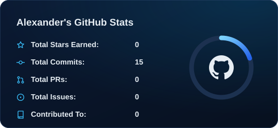
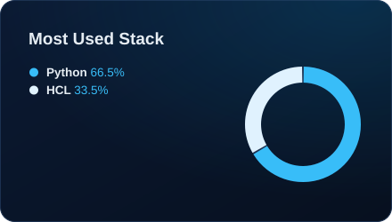
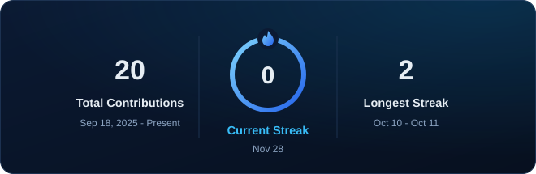

 

## 

I am an aspiring **Cloud Engineer** focused on **AWS** and **Azure**, building hands-on experience in designing, automating and operating cloud infrastructure.

I enjoy turning manual setups into **repeatable, well-documented infrastructure**: running workloads in containers and keeping them secure and observable with tools like Grafana, Prometheus and CloudWatch.

Currently open to **junior cloud and infrastructure roles, internships** and collaboration on open-source infrastructure projects.

 

---

## 

<table align="center">
<tr>
  <th colspan="2" align="center">CLOUD</th>
  <th colspan="1" align="center">CONTAINERS</th>
  <th colspan="1" align="center">SYSTEMS</th>
  <th colspan="3" align="center">MONITORING</th>
</tr>
<tr>
  <td align="center" width="105"><picture><source media="(prefers-color-scheme: dark)" srcset="./aws-dark.svg"/></picture> <b>AWS</b></td>
  <td align="center" width="105"> <b>Azure</b></td>
  <td align="center" width="105"> <b>Docker</b></td>
  <td align="center" width="105"> <b>Linux</b></td>
  <td align="center" width="105"> <b>Grafana</b></td>
  <td align="center" width="105"> <b>Prometheus</b></td>
  <td align="center" width="105"> <b>CloudWatch</b></td>
</tr>
</table>

<table align="center">
<tr>
  <th colspan="3" align="center">DATABASES</th>
</tr>
<tr>
  <td align="center" width="105"> <b>PostgreSQL</b></td>
  <td align="center" width="105"> <b>MySQL</b></td>
  <td align="center" width="105"> <b>MariaDB</b></td>
</tr>
</table>

<table align="center">
<tr>
  <th colspan="5" align="center">CURRENTLY LEARNING</th>
</tr>
<tr>
  <td align="center" width="105"> <b>Terraform</b></td>
  <td align="center" width="105"> <b>Ansible</b></td>
  <td align="center" width="105"> <b>Vault</b></td>
  <td align="center" width="105"> <b>Actions</b></td>
  <td align="center" width="105"> <b>Trivy</b></td>
</tr>
</table>

 

---

## 

<table>
<tr>
<td valign="top">

### [Secure AWS Platform](https://github.com/alevlaiva/Secure-AWS-Platform-DevOps) &nbsp;IN PROGRESS

**Hardened AWS infrastructure with a DevSecOps pipeline**

A secure AWS environment built entirely from code: a private VPC reached only through a bastion host, hardened Ubuntu servers, containers on segregated Docker networks, secrets kept in HashiCorp Vault with AWS KMS auto-unseal, and a GitHub Actions pipeline that scans, plans and deploys every change using short-lived OIDC credentials, with no stored AWS keys.

`AWS` · `Terraform` · `Ansible` · `Docker` · `Vault` · `GitHub Actions` · `Trivy`

</td>
</tr>
</table>

 

---

## 

  
  

  

 

---

## 

My focus is cloud and observability: building infrastructure on AWS and Azure, and making sure every system can be monitored, understood and recovered.

<table>
<tr>

<td width="50%" valign="top">

### Cloud Engineering

**Cloud Platforms**  
Core AWS and Azure services: compute, storage, networking and identity, and how they fit together into a working environment.

**Cloud Architecture**  
Designing environments that are scalable, highly available and cost-aware, with resources sized and organized for how they are actually used.

**Cloud Networking**  
Virtual networks, subnets, routing, load balancing and VPN connectivity, with traffic segmented so each workload only reaches what it needs.

**Identity and Security**  
Identity and access management, least-privilege permissions, firewall rules and security baselines that protect cloud resources by default.

**Containers**  
Packaging applications with Docker so they run the same way on any machine and move easily between on-premises and the cloud.

</td>

<td width="50%" valign="top">

### DevSecOps and Observability

**Infrastructure as Code**  
Defining networks, servers and permissions in Terraform and configuring hosts with Ansible, so a whole environment can be rebuilt from code in minutes.

**CI/CD without stored keys**  
GitHub Actions pipelines that scan, plan and apply changes only after approval, signing in to AWS with short-lived OIDC credentials instead of long-lived access keys.

**Secrets Management**  
Keeping passwords and keys in HashiCorp Vault, out of code and config files, and delivering them to services only at runtime.

**Security Scanning and Hardening**  
Catching leaked secrets and insecure configuration before they reach the cloud with gitleaks, tflint and Trivy, plus hardened SSH, host firewalls and least-privilege containers.

**Monitoring and Alerting**  
Collecting metrics and health checks with Prometheus and Amazon CloudWatch, visualizing them in Grafana dashboards, and setting alerts that flag problems before they affect users.

</td>

</tr>
</table>

 

---

## 

  
  
  

 

